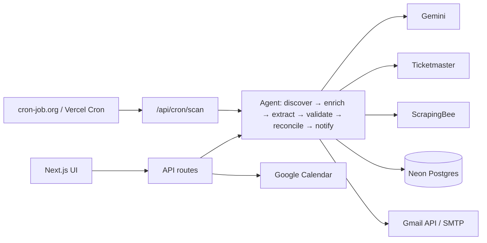

# Live Show Radar

An AI agent that watches the artists you follow and tells you **the moment** any of them announces a show in India —
Bengaluru first — with the venue, date, **early-bird status and deadline**, so you can buy the same day.

> **Live URL:** _add your Vercel URL here_ · **Repo:** _add your GitHub URL here_

<!-- Screenshots: add images to docs/ and link them here -->

**Screenshots:** _placeholder — Radar (dark/light), show drawer, Activity live log, map view._

## The 5-step workflow

1. **Artists** — ships with a 40-artist starter list; add by name (MusicBrainz autocomplete), import from Last.fm, or connect Spotify.
2. **Agent scans** — an external scheduler hits the app every 30 minutes; each run checks a small batch, or press **Check now** and watch it work live.
3. **Alert** — one Gmail email per run (Bengaluru + early-bird items first) plus an in-app bell.
4. **Decide** — open a show for the AI "Should I go?" brief and tier table with live IST countdowns.
5. **Book it** — **I'm going** creates Google Calendar events (concert, early-bird deadline, on-sale); without Google you get pre-filled calendar links.

No signup, no login wall, no onboarding. Every integration is an optional upgrade.

## Components Map

Full diagrams and the component table are in [`docs/COMPONENTS_MAP.md`](docs/COMPONENTS_MAP.md).



## Tech stack

Next.js 16 (App Router) · React 19 · TypeScript (strict) · Tailwind CSS 4 · Radix UI + lucide-react · Neon Postgres
(`@neondatabase/serverless`, server-only, parameterised SQL) · `@google/genai` (Gemini Flash only) · `googleapis` · nodemailer · zod · date-fns(-tz) ·
cheerio · fastest-levenshtein · Leaflet + OpenStreetMap · Vitest · ESLint + Prettier · Vercel.

## External APIs (10)

| API                                              | What it does here                                                                                  |
| ------------------------------------------------ | -------------------------------------------------------------------------------------------------- |
| **Gemini** (Google Search grounding + JSON mode) | Finds announcements, extracts structured shows, writes the "Should I go?" brief, answers questions |
| **ScrapingBee** (HTML + Google Search)           | Reads live ticketing pages for tiers/deadlines; fallback search                                    |
| **Gmail API**                                    | Sends alert emails as you (SMTP app-password fallback)                                             |
| **Google Calendar API**                          | Creates/deletes concert, early-bird and reminder events                                            |
| **Ticketmaster Discovery**                       | Official listings as a second source                                                               |
| **Spotify Web API**                              | Imports followed artists (allow-listed accounts only)                                              |
| **Last.fm**                                      | Imports top artists from a username                                                                |
| **MusicBrainz**                                  | Artist autocomplete + disambiguation                                                               |
| **Deezer**                                       | Artist photos (≥0.85 name match)                                                                   |
| **OpenStreetMap** (Nominatim + tiles)            | Venue geocoding and the map                                                                        |

## How scanning works

Per artist: **A** discover (Gemini grounded search, Ticketmaster, ScrapingBee Google fallback) → **B** enrich (scrape allow-listed ticketing
pages under a daily credit budget; JSON-LD parsed) → **C** extract (Gemini JSON mode, zod-validated, one repair retry) →
**D** validate (deterministic: right artist, in India, sane date, **every cited URL must be one the model was given**) with a 0–1
confidence score → **E** reconcile (dedupe incl. ±1 day, merge tiers/sources, derive early-bird status, detect changes, priority score) →
**F** notify (idempotent in-app + one email per run). Runs are single-flight (Postgres lock), time-budgeted, and every step writes a
plain-English line to the live **Activity** log.

## Run locally

```bash
npm install
cp .env.example .env.local    # everything is optional
npm run dev                   # http://localhost:3000
```

With no keys you'll see the Setup screen; add `DATABASE_URL` (Neon) first ([`SETUP.md`](SETUP.md)). Other commands:

```bash
npm run lint && npm run typecheck && npm test && npm run build   # all pass with NO env vars
npm run check:integrations    # ✅/❌ + latency for each configured API
npm run seed                  # load the starter artists
npm run check:secrets         # fails if a secret is exposed via NEXT_PUBLIC_
```

## Evaluation criteria → where it shows up

| Criterion          | How it's answered                                                                                                                                                                      |
| ------------------ | -------------------------------------------------------------------------------------------------------------------------------------------------------------------------------------- |
| UI/UX quality      | "Stage at night" design system, ticket-stub cards with live countdowns, radar sweep, map, skeletons, empty/error states, mobile-first                                                  |
| Complexity         | 6-stage multi-source agent, grounded search + scraping + structured extraction, deterministic validation, confidence + priority scoring, change detection, idempotent alerts, live log |
| User experience    | Value on first screen; one-tap Book / I'm going / Remind me; Undo instead of confirm dialogs                                                                                           |
| External API usage | 10 real integrations, each in `lib/integrations/<name>.ts` with typed `Result`s                                                                                                        |
| Nothing mandatory  | No signup/login/onboarding; every integration optional with a graceful "Not connected yet" state                                                                                       |

## Known limitations

- Early-bird data is only as good as what ticketing pages publish; many pages hide tiers behind JavaScript or lists changes late.
- Gemini grounded search can miss announcements that only exist on Instagram; the validator prefers dropping to guessing.
- Spotify connect only works for accounts the app owner has allow-listed (Development Mode), and needs a Premium owner.
- Free tiers apply (Gemini daily quota, ScrapingBee credits, Neon free tier, Vercel Hobby limits); the app meters and degrades instead of failing.
- Ticketmaster has thin India coverage; an empty result is normal.
- Scan latency is bounded by the scheduler (30 min) and Vercel's function time limit (batches of 4 artists per run).
- Database code is tested end to end against PGlite (Postgres in WASM) and smoke-tested against the live Neon database.
