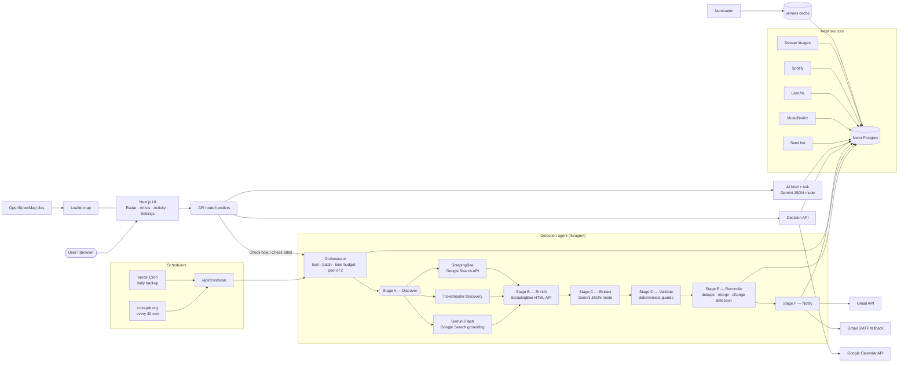

# Components Map

## (a) System overview



## (b) Components

| Component                                                     | Responsibility                                                                                    | Technology / API                                                     | Inputs                          | Outputs                                           | Failure behavior                                                                                                   |
| ------------------------------------------------------------- | ------------------------------------------------------------------------------------------------- | -------------------------------------------------------------------- | ------------------------------- | ------------------------------------------------- | ------------------------------------------------------------------------------------------------------------------ |
| **Env + registry** (`lib/env.ts`, `integrations/registry.ts`) | Parse env (everything optional), report which integrations are configured/connected               | zod                                                                  | `process.env`, `oauth_tokens`   | typed `env`, status map                           | Never throws; missing keys → "Not connected yet" UI                                                                |
| **Database client** (`lib/db.ts`)                             | Server-only Postgres access with typed rows (dates as strings, numerics as numbers)               | Neon serverless driver (HTTP)                                        | `DATABASE_URL`                  | rows or `null` client                             | `null` → every page renders the Setup screen                                                                       |
| **Scheduler endpoint** (`/api/cron/scan`)                     | Authenticated entry for scheduled scans; past-show sweep; early-bird deadline sweep               | Route handler, `CRON_SECRET` bearer                                  | Authorization header            | run summary JSON                                  | 401 bad secret · 503 secret unset · lock busy → no-op                                                              |
| **Orchestrator** (`agent/run-scan.ts`)                        | Lock, pick artists (oldest first, favourites alternate), concurrency 2, time budget, finalise run | Postgres `acquire_lock`                                              | trigger, optional artist ids    | `scan_runs`, `scan_logs`                          | One artist failing never fails the run; budget hit → `partial`; lock always released in `finally`                  |
| **Stage A — Discover** (`discover.ts`)                        | Find candidate India shows from three sources                                                     | Gemini + Google Search grounding · Ticketmaster · ScrapingBee Google | artist, today (IST)             | grounded text + sources, TM events, fallback URLs | Each source degrades independently; Gemini out of quota → ScrapingBee fallback                                     |
| **Stage B — Enrich** (`enrich.ts`)                            | Scrape allow-listed ticketing pages for tiers/deadlines; build the evidence bundle                | ScrapingBee HTML API, cheerio, JSON-LD                               | candidate URLs, existing shows  | labeled evidence blocks                           | Daily credit budget guard; 5xx retried once; 4xx never retried; scrape failure → search text only                  |
| **Stage C — Extract** (`extract.ts`)                          | Turn evidence into structured shows                                                               | Gemini JSON mode + zod, repair retry                                 | evidence bundle                 | candidates                                        | Invalid JSON twice → AI results dropped for the run; Ticketmaster and JSON-LD still pass through deterministically |
| **Stage D — Validate** (`validate.ts`)                        | Hallucination guards + confidence score                                                           | Pure code                                                            | candidates, bundle URLs, today  | valid candidates + drop reasons                   | Drops are logged in plain English; never calls AI                                                                  |
| **Stage E — Reconcile** (`reconcile.ts`)                      | Dedupe (±1 day), merge, derive early-bird status, detect changes, score priority                  | Pure planner + Postgres                                              | valid candidates, existing rows | `shows`, `show_changes`, `venues`                 | A failed save is logged and retried next run                                                                       |
| **Stage F — Notify** (`notify.ts`)                            | In-app alerts + one email per run, idempotent                                                     | Gmail API, SMTP                                                      | change ids                      | `alerts` rows, email                              | No Google/SMTP → email `skipped`, in-app still works; failures recorded, never duplicated                          |
| **Sweeps** (`agent/sweeps.ts`)                                | Mark past shows; flip `open` → `closing_soon` within 48 h with an alert                           | SQL                                                                  | now                             | updated rows + alerts                             | Cheap SQL only, runs even if a scan is busy                                                                        |
| **Gemini wrapper** (`integrations/gemini.ts`)                 | Grounded search, JSON mode, budget, retries                                                       | `@google/genai`                                                      | prompt, schema                  | `Result<…>`                                       | 429 → backoff / daily-quota detection; timeouts 30 s / 20 s                                                        |
| **ScrapingBee wrapper**                                       | HTML + Google Search with credit metering                                                         | ScrapingBee API                                                      | URL/query                       | cleaned page evidence / hits                      | `quota_exhausted` stops scraping for the day                                                                       |
| **Ticketmaster wrapper**                                      | Official listings, mapped defensively                                                             | Discovery API v2                                                     | artist                          | `TmEvent[]`                                       | Empty is "no data", not an error                                                                                   |
| **Google OAuth**                                              | One consent for Gmail + Calendar; encrypted tokens                                                | `googleapis`, AES-256-GCM                                            | auth code                       | encrypted refresh token                           | `invalid_grant` → "Reconnect Google"; no `TOKEN_ENCRYPTION_KEY` → button disabled                                  |
| **Email templates** (`email/templates.ts`)                    | Table-based HTML + text alert; subject by top-priority item                                       | pure                                                                 | alert items                     | `{subject, html, text}`                           | Escapes all scraped/AI text; ticket links must be allow-listed                                                     |
| **Decision API**                                              | going / maybe / not interested, calendar events, undo                                             | Google Calendar API                                                  | decision + options              | events or template links                          | Not connected → pre-filled template links; idempotent per (show, kind)                                             |
| **AI brief + Ask**                                            | "Should I go?" and natural-language Q&A over shows                                                | Gemini JSON mode                                                     | show row / ≤150 shows           | brief / answer + ids                              | Missing Gemini → "Connect Gemini…"; unknown ids filtered in code                                                   |
| **Artist sources**                                            | Seed, MusicBrainz autocomplete, Last.fm import, Spotify follow import, Deezer photos              | respective APIs                                                      | names / usernames               | `artists` rows                                    | Each optional; throttled 1 req/s; image needs ≥0.85 name match                                                     |
| **Venue geocoding**                                           | Venue coordinates for the map                                                                     | Nominatim (1 req/s, cached)                                          | venue + city                    | `venues.lat/lng`                                  | Falls back to city centre                                                                                          |
| **Rate limiter + locks**                                      | Abuse control, single scan at a time                                                              | Postgres functions                                                   | key                             | allow/deny                                        | Fails open if DB unavailable                                                                                       |
| **UI shell**                                                  | Header, bottom tabs, toasts, scan state                                                           | Next.js, Radix, Tailwind                                             | —                               | —                                                 | Skeletons, empty and error states everywhere                                                                       |
| **Radar**                                                     | Lanes (Act now / home / elsewhere), list + map, Ask box                                           | React, Leaflet + OSM tiles                                           | shows                           | cards, drawer                                     | Sample mode until real data exists                                                                                 |
| **Show drawer**                                               | Countdown, brief, tiers, actions, sources, history                                                | Radix Dialog                                                         | show id                         | decisions                                         | Deep link `/?show=<id>`                                                                                            |
| **Activity**                                                  | Live agent log (1.5 s polling), run history, usage meters                                         | polling `/api/scan/runs/[id]`                                        | run id                          | log list                                          | `aria-live`, icon + color per level                                                                                |

## (c) Sequence: new Bengaluru show, early bird open → email → "I'm going" → calendar

```mermaid
sequenceDiagram
  autonumber
  participant CJ as cron-job.org
  participant API as /api/cron/scan
  participant AG as Agent
  participant GM as Gemini (grounded)
  participant SB as ScrapingBee
  participant DB as Neon Postgres
  participant GA as Gmail API
  actor U as Karan
  participant UI as Radar UI
  participant GC as Google Calendar

  CJ->>API: GET (Bearer CRON_SECRET)
  API->>AG: runScan(cron)
  AG->>DB: acquire_lock('scan')
  AG->>GM: "find India shows for Artist" (Google Search)
  GM-->>AG: notes + grounded sources
  AG->>SB: render District ticket page
  SB-->>AG: HTML (JSON-LD, tiers)
  AG->>GM: extract structured shows (JSON mode)
  GM-->>AG: shows[] (zod-validated)
  AG->>AG: validate (India, date, evidence URLs) + confidence
  AG->>DB: upsert show, show_changes(new_show), venue
  AG->>DB: in-app alert (idempotent)
  AG->>GA: one email — Bengaluru + early bird first
  GA-->>U: "🎟️ Artist in Bengaluru … early bird open till …"
  U->>UI: tap "Open in Radar" (/?show=id)
  UI->>DB: load show, AI brief (cached by hash)
  U->>UI: "I'm going" → Add to calendar
  UI->>API: POST /api/shows/id/decision
  API->>DB: set decision; check calendar_events
  API->>GC: events.insert (concert, early-bird deadline)
  GC-->>API: event ids + links
  API->>DB: calendar_events (unique per show+kind)
  API-->>UI: created links → toast "Added to calendar"
```
